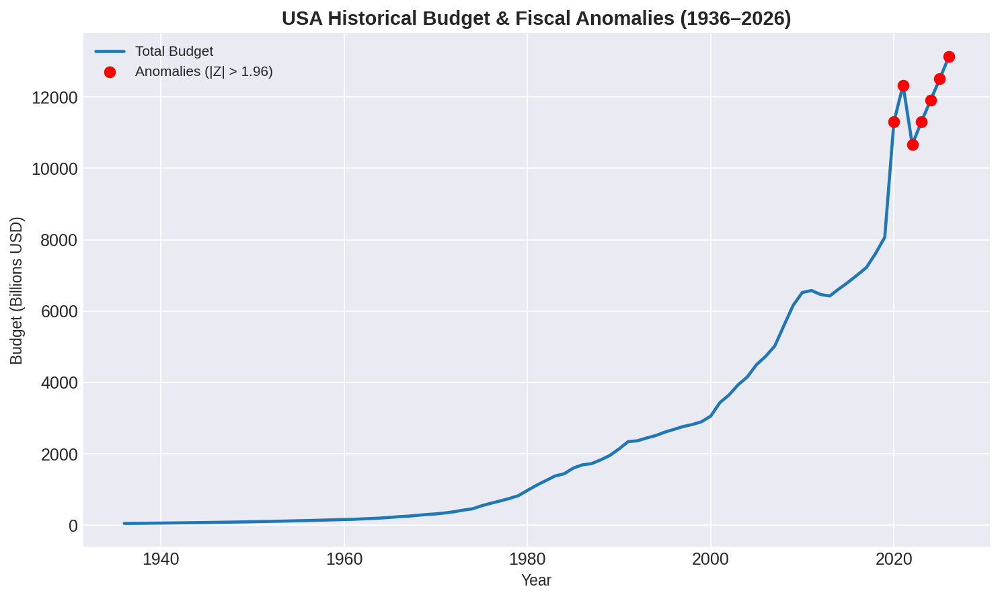
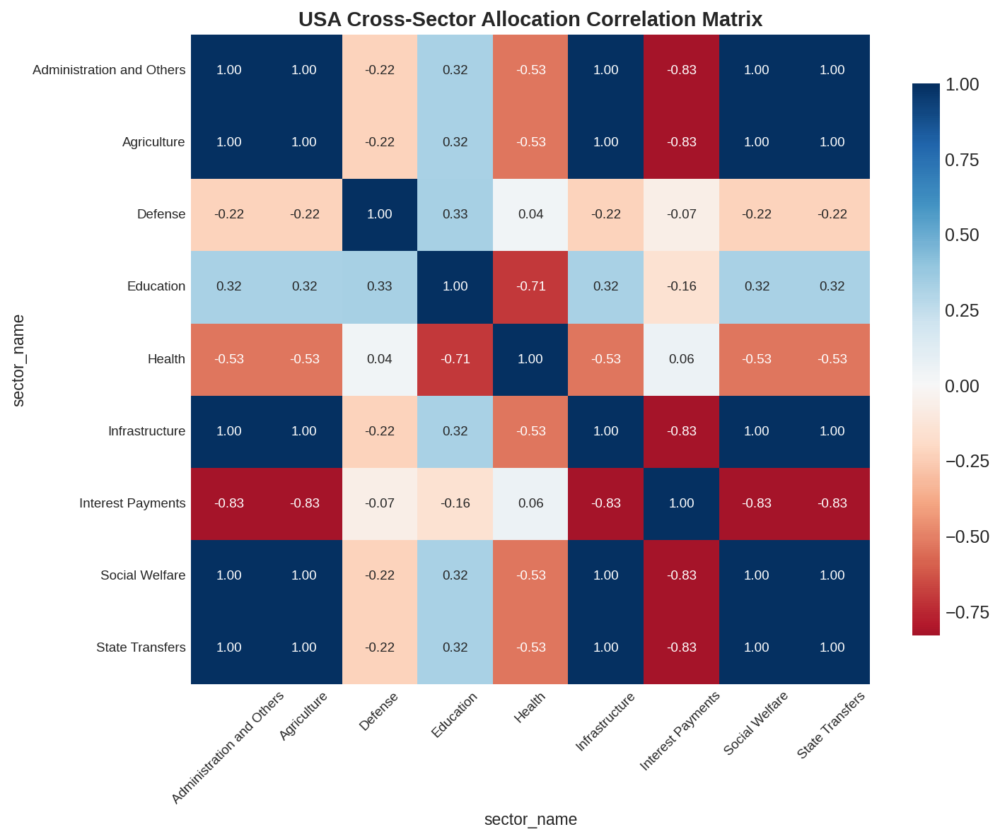
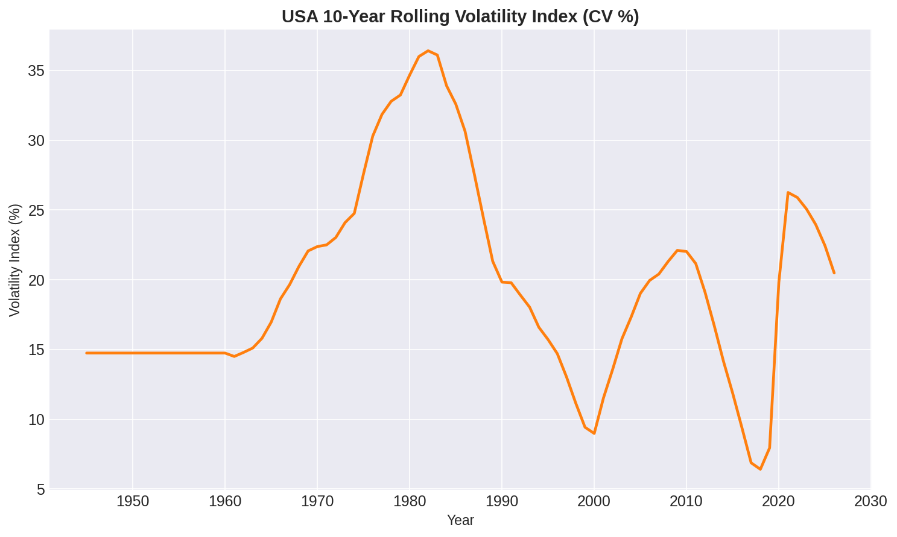
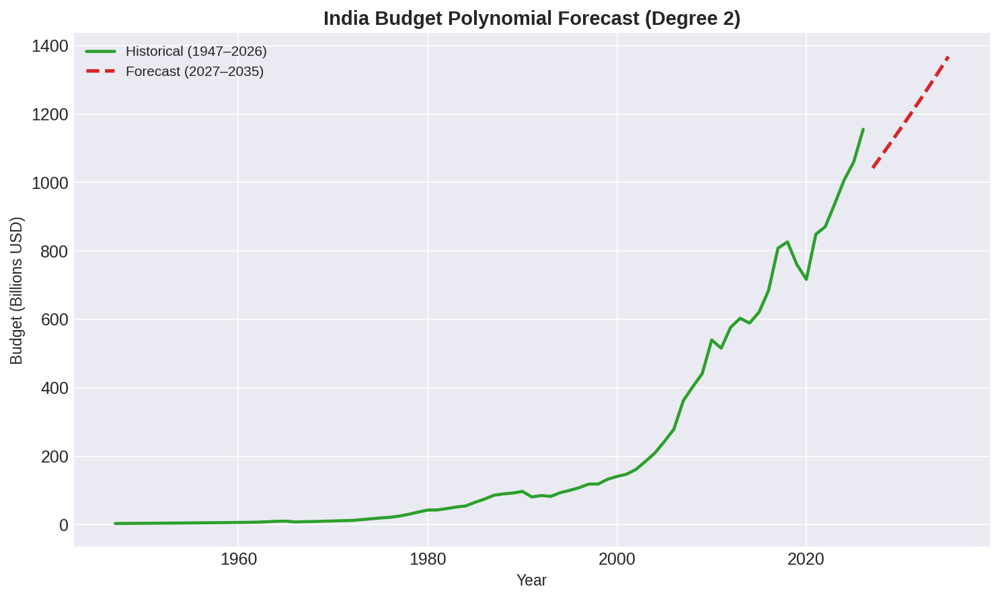

# 🌍 Global Government Budget Analytics

A Python and MySQL-based analytics project for exploring **government budgets, sector allocations, spending trends, anomalies, volatility, and future budget projections** across countries.

The project includes a Python ETL pipeline, normalized MySQL database, statistical analysis modules, and an interactive Streamlit dashboard.

## 🚀 Features

* CSV-to-MySQL ETL pipeline using Python and Pandas
* Normalized MySQL database for countries, budgets, and sector allocations
* Historical budget trend analysis
* 5-year rolling averages
* Sector dominance analysis using SQL window functions
* Statistical anomaly detection using Z-scores
* Cross-sector correlation analysis
* Rolling budget volatility analysis
* Polynomial budget projections with scenario shocks
* Defense vs. civilian spending analysis
* Interactive Streamlit dashboard with Plotly visualizations

## 🛠️ Tech Stack

**Python | Pandas | NumPy | MySQL | SQLAlchemy | SQL | Streamlit | Plotly**

## 🔄 Project Workflow

```text
CSV Data
   ↓
Python ETL
   ↓
MySQL Database
   ↓
SQL & Statistical Analysis
   ↓
Streamlit Dashboard
```

## 📊 Database Structure

```text
Countries
    ↓
Budgets
    ↓
Sector Allocations
```

The database stores country information, yearly total budgets, and detailed sector-level allocations.

## 📊 Visualizations & Key Insights

Below are the core analytical outputs generated from the normalized MySQL database (`global_budget_db`) and Python statistical modules.

---

### 1. Historical Budget Trajectory & Fiscal Anomalies (USA, 1936–2026)


- **What it shows:** Tracks 91 years of total US government spending alongside statistical outliers flagged at the **95% confidence threshold (`|Z-score| > 1.96`)**.
- **Key Insight:** Spending remained within historical variance for decades before crossing the anomaly threshold in **2020 ($11.31T, Z = 2.45)** and remaining elevated through **2026 ($13.13T, Z = 2.98)**, reflecting post-pandemic fiscal expansion.

---

### 2. Cross-Sector Allocation Correlation Matrix (USA)


- **What it shows:** An interactive Pearson correlation heatmap (`RdBu` scale) measuring how percentage allocations across all 9 public spending sectors move relative to one another over time.
- **Key Insight:** Highlights structural funding trade-offs—most notably a strong inverse correlation between **Education and Health (`-0.71`)** and between **Interest Payments and core public sectors (`-0.83`)**, showing how rising debt servicing compresses discretionary spending.

---

### 3. 10-Year Rolling Budget Volatility Index (USA)


- **What it shows:** Measures long-term fiscal stability using a 10-year rolling **Coefficient of Variation (`σ / μ × 100`)**.
- **Key Insight:** Captures major macroeconomic volatility waves—peaking above **36%** in the early 1980s, dropping to historic lows near **6.5%** around 2018, and spiking again above **25%** following the 2020 fiscal shock.

---

### 4. Polynomial Budget Projection (India, 2027–2035)


- **What it shows:** A 2nd-degree least-squares polynomial regression (`np.polyfit`) fitted to India's historical budgets (**1947–2026**) to project spending trajectories through **2035**.
- **Key Insight:** Projects steady parabolic expansion from **$1,042.17B in 2027** to **$1,367.53B by 2035**, serving as a baseline for the Streamlit dashboard's interactive **-50% to +100% macroeconomic shock simulator**.

## 📈 Key Analytics

* Budget growth and historical trends
* Sector allocation patterns
* Z-score based outlier detection
* Cross-sector Pearson correlation
* Rolling volatility and statistics
* Polynomial trend projections
* Civilian-to-defense spending ratios


